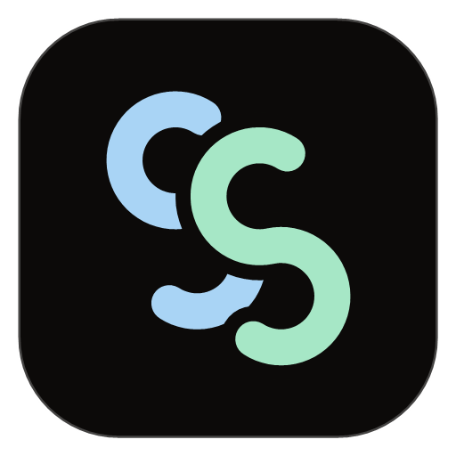

<div align="center">



# StackSpire

**Ваши подписки. Ваши серверы. Одно подключение.**

VPN-клиент для Android, Windows, macOS и Linux.<br />
Собственный интерфейс, гибкая маршрутизация и сетевое ядро Mihomo.

[](https://github.com/Axiol1te/StackSpire/actions/workflows/stackspire-build.yml)
[](https://github.com/Axiol1te/StackSpire/releases/latest)
[](LICENSE)

[**Скачать приложение**](https://github.com/Axiol1te/StackSpire/releases/latest) · [Все сборки](https://github.com/Axiol1te/StackSpire/releases) · [Статус сборки](https://github.com/Axiol1te/StackSpire/actions)

</div>

---

## Главное — подключиться

StackSpire объединяет управление подписками и подключением в одном приложении. На главном экране — кнопка подключения, выбранный сервер и скорость передачи данных. Настройки маршрутизации и инструменты диагностики доступны отдельно.

### Возможности

- **Несколько подписок.** Импорт по ссылке и из файла, обновление профилей и переключение между ними.
- **Серверы выбранной подписки.** Поиск, выбор узла и проверка задержки.
- **Информация о тарифе.** Срок действия, использованный трафик и лимит, если провайдер передаёт эти данные.
- **Маршрутизация Mihomo.** Правила из конфигурации, глобальный режим и прямое подключение.
- **Статистика.** Скорость загрузки и отдачи, объём трафика и проверка внешнего IP-адреса.
- **Быстрый доступ.** Плитка включения VPN на Android; управление через трей на компьютере.
- **Свой внешний вид.** Светлая и тёмная темы, анимации и интерфейс для телефона и рабочего стола.

## Загрузка

Установочные файлы находятся в [GitHub Releases](https://github.com/Axiol1te/StackSpire/releases/latest).

| Система | Архитектура | Файлы |
| --- | --- | --- |
| Android | ARM64, ARMv7, x86_64 | APK |
| Windows | x64 | Установщик EXE, переносимая ZIP-версия |
| macOS 12+ | Apple Silicon, Intel | DMG, ZIP |
| Linux | x64 | DEB, RPM, AppImage |

Для большинства современных Android-телефонов нужен APK с `arm64-v8a` в названии. Для Mac с процессором Apple — `arm64`, для Intel — `amd64`.

Сборки Linux создаются на Ubuntu 24.04. Для старых дистрибутивов может потребоваться сборка из исходников. Windows-пакеты пока без подписи издателя; macOS-пакеты имеют локальную ad-hoc подпись и не нотарифицированы Apple.

## Первое подключение

1. Установите приложение для своей системы.
2. Откройте **Подписки** и добавьте ссылку на профиль или импортируйте файл конфигурации Mihomo / Clash YAML.
3. Выберите подписку и сервер.
4. На главном экране нажмите кнопку подключения. На Android подтвердите системный запрос на создание VPN.

StackSpire — клиент: для подключения нужна ваша подписка или собственный сервер. Серверы и платные тарифы в приложение не включены.

## Сборка из исходников

В репозитории находятся исходники интерфейса, ядра, платформенных сервисов и сценарии упаковки. Ядро включено в дерево проекта; отдельная загрузка Git-подмодулей не требуется.

Сборки в Actions используют **Flutter 3.47.6**, **Go 1.27.1** и **Rust stable**. Для Android также нужны **JDK 17**, Android SDK и **NDK r28c**. Для настольных платформ необходимы их нативные инструменты сборки: Visual Studio с C++ для Windows, Xcode для macOS, CMake/Ninja и библиотеки GTK для Linux.

```sh
git clone https://github.com/Axiol1te/StackSpire.git
cd StackSpire
flutter pub get
```

Затем выполните команду для нужной платформы:

```sh
dart setup.dart android --arch arm64 --env pre
dart setup.dart windows --env pre
dart setup.dart macos --env pre
dart setup.dart linux --env pre
```

Windows, macOS и Linux собираются на соответствующей ОС. Android можно собирать на любой из них. Для Android без release-ключа создаётся отдельная тестовая версия с идентификатором `com.stackspire.vpn.dev`.

## Автоматические сборки

Изменения кода в `main` запускают независимые задания для семи сочетаний системы и архитектуры. Каждое задание проверяет исходники и тесты, затем собирает пакеты. После успеха всех заданий создаётся Release с установочными файлами, информацией о сборке и контрольными суммами SHA-256.

Изменения Markdown-документации не запускают повторную компиляцию. Ключ подписи Android хранится в GitHub Secrets и не входит в исходники.

## Лицензия

[GNU General Public License v3.0](LICENSE).
